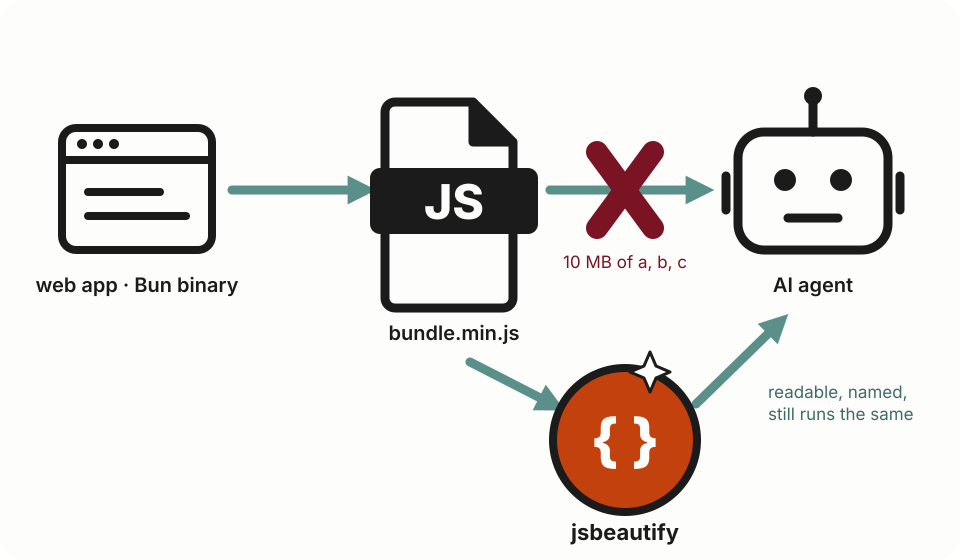
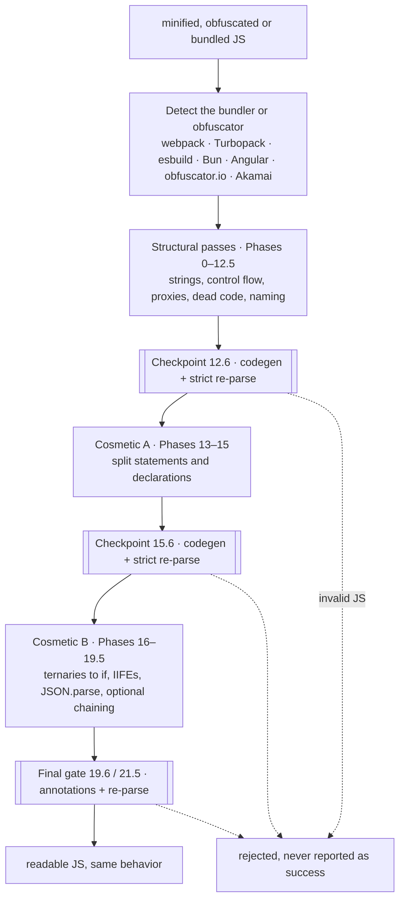
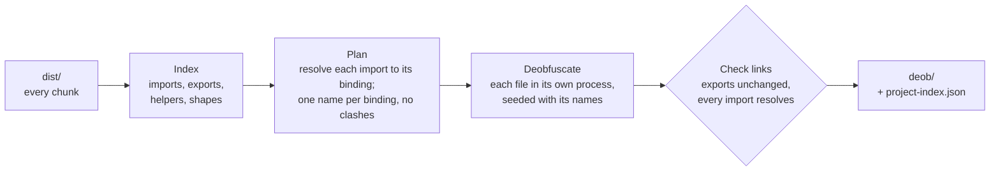
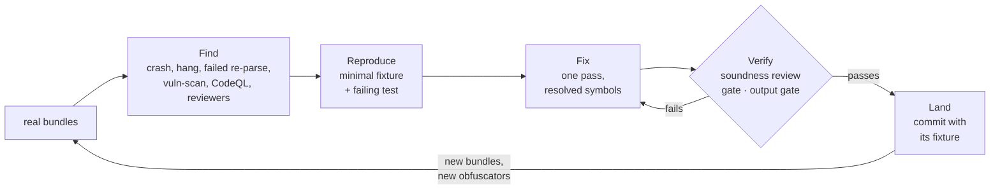

<h1 align="center">jsbeautify</h1>

<p align="center">
  <b>The JavaScript deobfuscator built for AI agents, and refined by them.</b><br>
  Minified, bundled or obfuscated JavaScript in. Readable code that still runs the same out.
</p>

<p align="center">
  <a href="https://github.com/coleleavitt/jsbeautify/actions/workflows/ci.yml"></a>
  <a href="https://crates.io/crates/jsbeautify"></a>
  <a href="LICENSE.md"></a>
  
</p>

<p align="center">
  <a href="#install">Install</a> ·
  <a href="#usage">Usage</a> ·
  <a href="#with-an-agent">With an agent</a> ·
  <a href="docs/refinement.md">Refinement loop</a> ·
  <a href="docs/cli.md">CLI reference</a>
</p>

<p align="center">
  
</p>

These days agents, not people, read most deobfuscated code. jsbeautify is
built for that reader. Its output, logs and inspection commands are made for a
model to query. Its pipeline is a list of small passes an agent can find, change
and review. And it ships the reviewers, checks and [refinement
loop](docs/refinement.md) that let agents find its bugs and fix them.

- **Whole builds, not just files.** `--project` deobfuscates every chunk of a
  code-split build together and gives each cross-file binding one name. On the
  Claude Code 2.1.331 Bun build (3,594 chunks) it links 107,390 imports with
  0 broken, in 14 seconds and 1 GB of RAM.
- **Names that survive a release.** A binding nothing names is named after
  the shape of its code, not the chunk hash, so 93% of those names stay the
  same from 2.1.330 to 2.1.331 and two versions can be diffed.
- **Behavior first.** Every rewrite is checked for symbol identity, shadowing,
  evaluation order, `eval` and `this`. The output is code-generated and
  parsed again at two checkpoints, so invalid JavaScript is never reported as
  success.
- **Every bundler you'll meet.** webpack 4/5, Turbopack (Next.js 13–16),
  esbuild (all 63 runtime helpers), Bun, Angular, javascript-obfuscator,
  Akamai Bot Manager.
- **Never runs what it reads.** Hostile input must not make it panic, hang,
  exhaust memory or write outside the output directory.

## Before / after

Input in the style of javascript-obfuscator (string array with an offset
decoder, hex literals, bracket access, and a flattened `switch` dispatcher):

```js
var _0x1a2b=["Hello","log","world","join"];function _0xdec(_0x3c4d){_0x3c4d=_0x3c4d-0x64;return _0x1a2b[_0x3c4d];}var _0x9c=[];var _0x7a="2|0|1".split("|");var _0x8b=0x0;while(!![]){switch(_0x7a[_0x8b++]){case"0":_0x9c["push"](_0xdec(0x66));continue;case"1":console[_0xdec(0x65)](_0x9c[_0xdec(0x67)]("\x20"),!0x0);continue;case"2":_0x9c["push"](_0xdec(0x64));continue;}break;}
```

`jsbeautify -d --isolated input.js`:

```js
var var_1 = [];
var_1.push("Hello");
var_1.push("world");
console.log(var_1.join(" "), true);
```

Strings are decoded, the dispatcher loop becomes straight-line code, and
`!0x0` and `["push"]` become `true` and `.push`. The decoder and its string
array are no longer used, so they are removed. `--isolated` tells jsbeautify
that no other script reads this file's globals, so top-level names may be
renamed or removed.

## Install

Needs Rust 1.97 or newer.

```bash
cargo install jsbeautify --locked                                          # crates.io
cargo install --git https://github.com/coleleavitt/jsbeautify --locked     # latest commit
```

## Usage

```bash
jsbeautify in.js -o out.js                    # format only (js-beautify flags and .jsbeautifyrc)
jsbeautify -d in.js -o out.js 2>deob.log      # deobfuscate; stderr is the phase log
jsbeautify -d --isolated in.js                # also rename a classic script's top-level names
jsbeautify -d --project dist/ -o deob/        # a whole code-split build, one name per binding across chunks
jsbeautify in.js -d --sourcemap in.js.map     # take the original names from a source map

jsbeautify split-sources bundle.js -o src/    # rebuild the source tree
jsbeautify extract-modules bundle.js -o mods/ # one file per webpack/Turbopack module
jsbeautify align v1.js v2.js                  # stable diff between two bundle versions
jsbeautify analyze-vm vm.js -o report.json    # static look at a JS VM / embedded Wasm (never runs it)

jsbeautify scope in.js | jq .unresolved      # Oxc's symbol table as JSON (also: ast, cfg)
```

The full flag list, js-beautify compatibility notes and the library API are in
[`docs/cli.md`](docs/cli.md).

### With an agent

Point your agent at the file and let it run the tool, not read the bundle:

- `jsbeautify -d` writes the result to stdout and a log to stderr: one
  `check:` line per bundler detector, one count per phase, and a line saying
  whether the output re-parsed after each checkpoint.
- `scope`, `cfg` and `split-sources` let an agent answer "who writes this
  name" or "what does this function do" without loading a 10 MB file into its
  context.
- Before you trust a `-d` result, run the output gate: `node --check`, and
  the same run on input and output when the input runs on its own
  ([`docs/refinement.md`](docs/refinement.md#4-verify)).

## Project goals

1. **Behavior first.** A rewrite has to keep the program's behavior on every
   input. Symbol identity, shadowing, evaluation order, coercion, `eval` and
   `this` are checked before anything is folded, inlined, deleted or renamed.
   A pass that is wrong on some input is worse than no pass at all.
2. **Agent-first.** The output and the logs are written for a model to read.
   Each command answers one question and prints data (JSON, DOT, logs) that an
   agent can query.
3. **Autonomous refinement.** Agents improve the tool they rely on. The repo
   ships the instructions, reviewers and checks that let an agent run
   find → reproduce → fix → verify without a human
   ([`docs/refinement.md`](docs/refinement.md)).
4. **Hostile input.** Inputs are obfuscated on purpose and some are malicious.
   No input should make jsbeautify panic, hang, exhaust memory or write outside
   its output directory, and it never runs the code it reads.

## How it works



With `--project`, every chunk of a build is read first so a binding gets one
name in every file:



And agents keep improving it with one loop ([`docs/refinement.md`](docs/refinement.md)):



## Design

- **Phase-based.** `-d` is an ordered list of small Oxc passes, grouped by
  bundler under `src/ast_deobfuscate/` and run by
  `src/ast_deobfuscate/engine/`. Small passes are easier for an agent to find,
  change and review, and the phase log shows which pass made a change.
- **Checkpoints.** The pipeline generates code and parses it again into a fresh
  arena twice (Phases 12.6 and 15.6). This bounds memory and makes sure invalid
  JavaScript is never reported as success.
- **Sized stacks.** Parsing and traversal run on a thread whose stack is sized
  from the input, so deep nesting cannot overflow it.

The phase order and project mode are in [`docs/pipeline.md`](docs/pipeline.md).

## Development

Most changes here are made by coding agents (Claude Code, Codex). The rules
they follow are in [`AGENTS.md`](AGENTS.md); `CLAUDE.md` adds the Claude
Code hooks, reviewer subagents and skills.

```bash
cargo build --release              # target/release/jsbeautify
cargo fmt --check                  # the gate, in order
cargo clippy --all-targets -- -D warnings
cargo test --all-targets           # unit tests + tests/integration (one aggregated target)
```

### Layout

| Path | What it is |
|---|---|
| `src/ast_deobfuscate/` | The passes, by bundler (`webpack/`, `turbopack/`, `bun/`, `angular/`, `akamai/`), and `engine/`, which runs them in order |
| `src/beautifier/` | Plain formatting with js-beautify-compatible layout |
| `src/project/` | `--project`: a whole code-split build with names shared across files |
| `src/vm_analysis/` | Static JS VM and Wasm inspection. It never executes anything |
| `src/inspect/` | The `ast`, `scope` and `cfg` commands |
| `src/cross_version/`, `src/sourcemap/`, `*_extract*` | Alignment, source maps, bundle and source-tree rebuilding |
| `src/bin/jsbeautify_app/` | CLI parsing and command runners |
| `tests/integration/`, `tests/fixtures/<bundler>/` | Integration tests and their inputs |
| `docs/` | [CLI](docs/cli.md), [pipeline](docs/pipeline.md), [refinement loop](docs/refinement.md) |

## License

[MIT](LICENSE.md)
