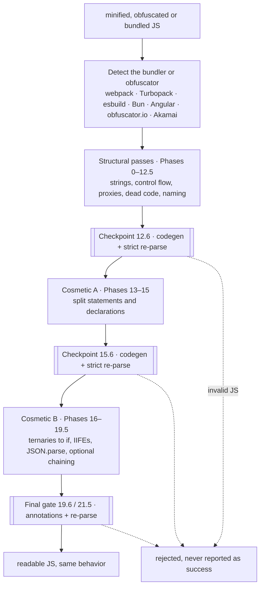
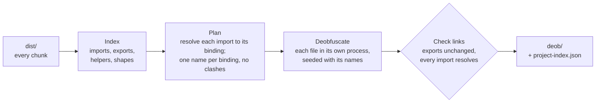

# Deobfuscation pipeline



`--deobfuscate` is an ordered AST pipeline. The implementation is split by
lifetime, not into one source file per numbered phase:

1. **Pre-AST input handling** decrypts supported encrypted `eval` payloads.
2. **Structural arena (Phases 0–12.5)** parses with Oxc, runs Akamai and Bun
   prepasses, control-flow and string decoding, proxy/function simplification,
   dead-code/dead-variable sweeps, normalization, and variable naming.
3. **Phase 12.6 checkpoint** code-generates the structural result, drops the
   Oxc bump arena, and re-parses into a fresh arena. This bounds peak memory and
   rejects invalid generated JavaScript.
4. **Cosmetic-A arena (Phases 13–15)** removes empty statements, splits sequence
   and multi-variable statements, and runs another validated dead-variable
   sweep.
5. **Phase 15.6 checkpoint** repeats the codegen, arena reset, and strict
   re-parse before the final transforms.
6. **Cosmetic-B arena (Phases 16–19.5)** converts statement-level ternaries,
   `switch(true)`, and short circuits; evaluates safe literal `JSON.parse`
   calls; normalizes optional/nullish syntax; unwraps safe IIFEs; detects
   esbuild helpers; and performs the final dead-variable sweep.
7. **Final output (Phases 19.6–21.5)** validates AST codegen, adds webpack,
   esbuild, Bun, enum, namespace, and arrow annotations, then validates the
   post-annotation JavaScript again.

The checkpoints are deliberate correctness and memory boundaries. State that
must survive them (currently the Bun helper map and source type) is passed
explicitly; all arena-owned AST data is discarded. See
`src/ast_deobfuscate/engine/structural.rs`,
`src/ast_deobfuscate/engine/cosmetic.rs`, and
`src/ast_deobfuscate/engine/final_output.rs` for the authoritative order.

### Project mode (several chunks of one build)



`jsbeautify -d --project dist/assets -o deob/` deobfuscates the chunks of a
code-split build (esbuild/rollup/vite `import { a as e } from "./chunk-X.js"`,
Turbopack chunks) together. It reads every file first, resolves each import to
the binding it links, and gives that binding one name in every file: the
runtime helper it is (`__export`, `__commonJS`, … imported from another chunk,
which also lets the importer's `__export(…)` calls and lazy modules be named),
the name its own chunk gives it, its real export name, or a synthetic name:
`<chunk>_<export>`, or, when the chunk's file name is only a content hash
(`chunk-1a2b3c4d.js`, as Bun and esbuild emit), the shape of the binding's
declaration (`fn_1a2b3c4d`, `class_…`, `val_…`). The shape erases minified
names and keeps node kinds, operators, literals and property names, so it
stays the same across releases while the code does: diff two versions of a
build by these names. Two bindings that one file sees never share a name;
the later one gets `$N`.
Exports no file of the project imports are the public surface, so their short
names count as names; `--short-export-names` is therefore ignored in project
mode. `--keep-fn-names` and `--window-alias-es5` apply to every file; with
`--keep-fn-names` a binding a function or class takes its `.name` from keeps
its name, and the chunks that import it use that name too.
Mangled Turbopack keys are named by the `esmReexport`
(`S([…])`) lists of other chunks. Import and export names never change. The
output folder mirrors the input (other files are copied), with per-file logs in
`.jsbeautify/logs/` and `project-index.json` (module links, plan, counts and a
check that every import still resolves to an export of its target). Single-file
output is unchanged.

A file that is not valid UTF-8 is read as Latin-1 (Bun emits `latin1`
modules), with a warning naming the file and byte; a zstd or gzip file is
reported as compressed.

Phase 12.4 (project mode, modules) names the rest the same way: each minified
top-level function, class or initialized variable that is not exported, and
each function or class declared inside a function, gets the shape of its own
code (`fn_…`, `class_…`, `val_…`) unless an earlier phase found a real name.
The shape ignores minified names and the shape names of other bindings, so an
edit to one function does not rename its callers. Locals that are neither
(parameters, nested variables) keep slot names (`v0`, `v1`) that repeat across
files: search for one only in the function that declares it.

To compare two versions of a build, run `jsbeautify diff-tree OLD NEW` on the
two output folders. It pairs functions by name across all files (chunk files
are renamed every build), then matches the rest, whose code and so whose
shape name changed, by their strings, property names and named references:

```bash
jsbeautify diff-tree v1.deob v2.deob -o diff.json
jq '.renamed[] | "\(.old.name) -> \(.new.name) \(.score)"' diff.json
```

Functions whose code changed too much for that are still paired when they are each other's clear best candidate (`weak_renamed` in the report, `--weak-min-score`, 0.25 by default), and are kept apart from `renamed`.

On Claude Code 2.1.330 → 2.1.331, 84% of the functions that read a
`tengu_` flag keep their name, and `diff-tree` pairs most of the rest
(94% together; 35% before Phase 12.4).

## Tracing a run

- stderr carries one count line per phase and one `check:` line per bundler
  detector; stdout (or `-o`) is the result.
- `JSB_TRACE_DEOB=1` adds a line per rewritten node.
- `JSB_MEM=1` prints resident memory at each checkpoint.
- A run whose output survived both checkpoints logs
  `Phase 19.6: Generated output re-parse succeeded` and the same line for
  `Phase 21.5`. Project mode refuses a file without both.
